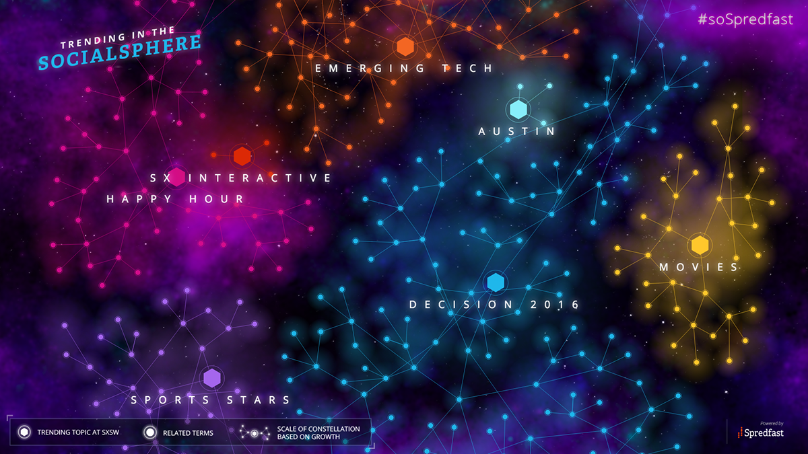
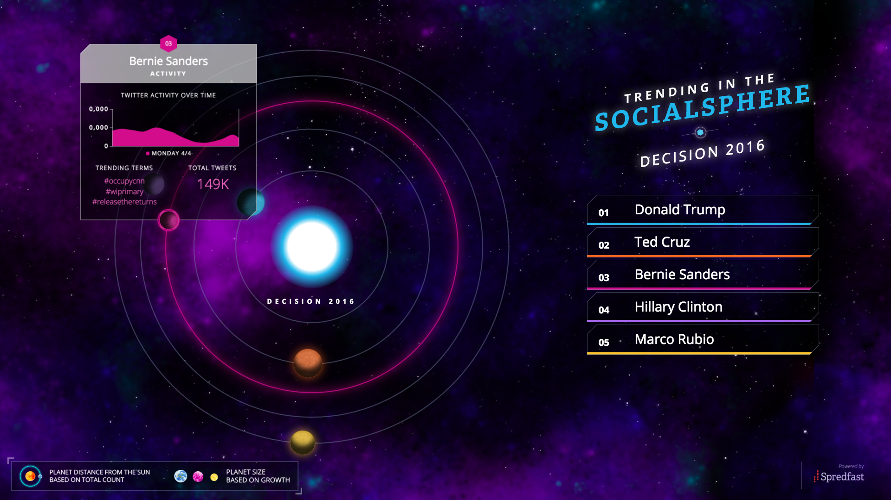

# Galaxy

### An Interactive Data Visualization for SXSW 2016

Galaxy was an interactive, full-screen visualization built to demonstrate the capabilities of the Mass Relevance platform as used by Spredfast at SXSW 2016.

The experience organized information into a "Galaxy" of constellations and planets and randomly focused on topics. Each constellation represented a topic, while individual planets represented related subtopics. It was designed to run continuously, 24 hours a day.

The visualization was intentionally flexible, allowing virtually any subject matter to be represented through the same interface.

## Technical Implementation

Galaxy combined several rendering and animation technologies because no single solution could deliver the entire experience.

- **D3.js:** Processed topic data, positioned and connected stars, and animated the constellations.
- **Canvas:** Handled the animation that brought stars from outside the main presentation into focus.
- **CSS Animations:** Controlled planetary orbits and kept their shadows correctly positioned throughout the movement.
- **Velocity.js:** Provided smooth, full-screen fade transitions between visual states.

**_Note:_** _The demonstration video doesn't fully capture the smoothness of the full-screen fade transitions due to limitations in the recording and rendering process._

I built the entire frontend, integrating data from existing APIs and coordinating these technologies into a continuous, animated experience.

## Screenshots and Demo

# 👁️ [Watch the Galaxy demonstration video](https://zero0halo.github.io/galaxy/) 👁️
